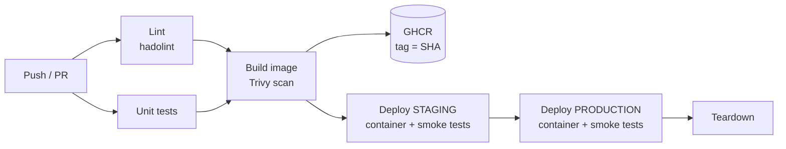

# GitHub Actions Pipeline Demo: Lint, Test, Build & Deploy


> Demo project with example values only. It showcases a CI/CD pattern; no real infrastructure or credentials are included.

A complete pipeline that runs **entirely on GitHub-hosted runners (no cloud account needed)**: lint, unit tests, image build, vulnerability scan, registry publish, and temporary deployments (staging, then production) with health checks, smoke tests and automatic teardown.

## Pipeline



| Stage | What it does |
|---|---|
| Lint | Dockerfile checked with hadolint |
| Test | Python unit tests |
| Build | Docker build, Trivy scan, image saved as artifact, pushed to GHCR on push |
| Deploy staging / production | Temporary container per environment, waits for Docker health status, smoke tests (health and environment config), container removed |

## Highlights

- Zero secrets and zero cost: uses only `GITHUB_TOKEN`.
- Immutable image tags (commit SHA), no `latest`.
- Same image promoted through staging then production.
- Hardened container: non-root, read-only filesystem, dropped capabilities, HEALTHCHECK.
- Diagnostics on failure; teardown always runs.

## Local run

```bash
docker build -t demo-api:local . && docker run -p 8080:8080 demo-api:local
curl localhost:8080/healthz
python -m unittest discover -s app -v
```

## Possible improvements

Image signing (cosign), SBOM, deploy to a real server via SSH, environment protection rules with required reviewers.
